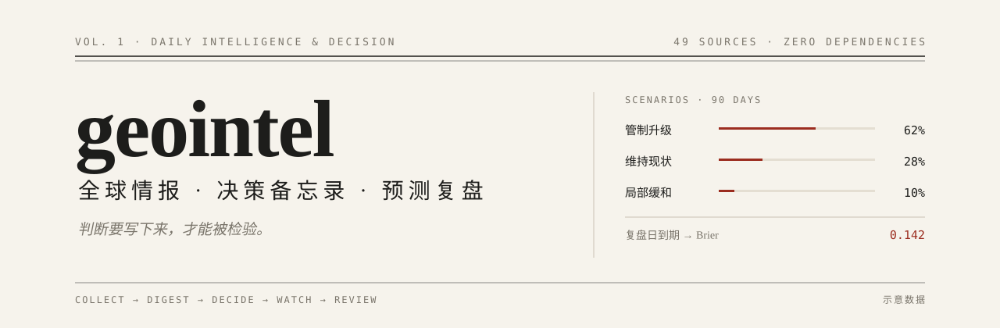

<p align="center">
  <a href="https://greatbeing.github.io/geointel/"></a>
</p>

<p align="center">
  <a href="https://greatbeing.github.io/geointel/"><b>在线阅读</b></a>
  &nbsp;·&nbsp;
  <a href="https://greatbeing.github.io/geointel/track-record.html">预测战绩</a>
  &nbsp;·&nbsp;
  <a href="https://greatbeing.github.io/geointel/decisions.html">备忘录</a>
  &nbsp;·&nbsp;
  <a href="https://greatbeing.github.io/geointel/alerts.html">告警</a>
  &nbsp;·&nbsp;
  <a href="https://greatbeing.github.io/geointel/calibration.html">校准</a>
</p>

<p align="center">
  <a href="https://github.com/Greatbeing/geointel/actions/workflows/test.yml"></a>
  
  
</p>

<br>

> 多数情报工具止于「发生了什么」。geointel 多走三步：**它会给出概率，写下自己怎样会错，并在到期那天认账。**

<br>


<br>

### 四条原则

<table>
<tr>
<td width="50%" valign="top">

**只说材料里有的**<br>
<sub>每个结论附原文链接与抓取时间。材料不够，就写「材料不足」，不让模型补。</sub>

</td>
<td width="50%" valign="top">

**给概率，不给形容词**<br>
<sub>「可能」「或将」不算判断。备忘录写情景概率、触发条件、证伪条件和复盘日期。</sub>

</td>
</tr>
<tr>
<td valign="top">

**宁缺毋滥的告警**<br>
<sub>主体、动作、对象须在同一篇材料里同时成立；可再请 LLM 逐条复核，出错时降级而不沉默。</sub>

</td>
<td valign="top">

**到期认账**<br>
<sub>复盘日自动结算 Brier 分数。猜对的、猜错的，都留在战绩页上。</sub>

</td>
</tr>
</table>

<br>

### 开始

```bash
./run-collect.sh                     # 采集，并评估触发条件
./run-digest.sh                      # 今日简报
./run-decide.sh "未来 90 天半导体出口管制升级的概率与应对" --horizon 90 --slug chips
python3 render.py                    # 生成 docs/ 静态站
python3 -m unittest discover -s tests
```

只需要 Python 标准库与 SQLite FTS5。LLM 走本机 magpie 网关 `127.0.0.1:3425`。

<br>

<details>
<summary><b>组件</b></summary>
<br>

| | |
|---|---|
| `collect.py` | 并发抓取、容错解析、URL 去重；结束时汇总失败源 |
| `store.py` | SQLite + FTS5；中文问题经 `LEXICON` 映射为英文检索词 |
| `market_collect.py` | 利率与汇率（FRED · ECB · Frankfurter，免 key） |
| `digest.py` | 每日简报 |
| `decide.py` | 决策备忘录，落盘即评结构分 |
| `watch.py` | 触发条件：关键词组、排除词、LLM 复核、推送去重 |
| `score.py` · `review.py` | 结构分与 Brier 校准 |
| `render.py` | 离线可读的静态站，单文件 CSS，无外链 |
| `llm.py` | 网关客户端：预算翻倍重试，失败换模型 |

</details>

<details>
<summary><b>触发条件写法</b></summary>
<br>

```json
{
  "id": "t2", "type": "count", "threshold": 2,
  "keyword_groups": [
    ["netherlands", "japan", "south korea"],
    ["adopts", "aligned with us", "implements"],
    ["export control", "export restrictions"]
  ],
  "exclude_keywords": ["education", "exam"]
}
```

组内任一，组间全部。`exclude_keywords` 命中即排除。ASCII 词按词边界匹配、兼容复数；中日韩词按子串。
旧式 `keywords` 仍兼容。`value` 型触发器绑定 `series` 时按市场数据自动判定，否则列入「需人工读数」。

</details>

<details>
<summary><b>配置与运行</b></summary>
<br>

| 环境变量 | 作用 |
|---|---|
| `GEOINTEL_WATCH_LLM_VERIFY=1` | 开启告警 LLM 语义复核（同 `--llm-verify`），默认关闭 |
| `GEOINTEL_ALERT_WEBHOOK` | 飞书机器人；只推新激活的触发器，失败下轮重试 |

| timer | 周期 | |
|---|---|---|
| `geointel-collect` | 每 2 小时 | 采集 · 评估 · 发布 |
| `geointel-digest` | 00:20 UTC | 每日简报 |
| `geointel-watch` | 00:45 UTC | 评估兜底 |
| `geointel-decide` | 01:00 UTC | 轮转生成一份备忘录 |

运行于 Instabox 云机，systemd user timer 驱动；空闲挂起后由 `Persistent=true` 补跑。

</details>

<details>
<summary><b>版式</b></summary>
<br>

站点是给人读的报告，不是仪表盘：运维数字不上页面；出处压成灰色小字；概率渲染为数字加一条发丝线，50% 就是半条。单栏 720px，衬线标题，深色与打印样式齐备。

</details>

<br>

<p align="center"><sub>横幅中的概率与分数为示意。真实记录见 <a href="https://greatbeing.github.io/geointel/track-record.html">预测战绩</a>。</sub></p>
